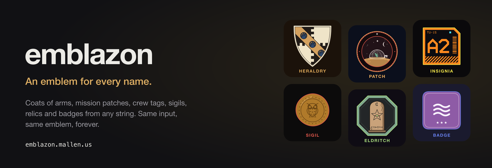
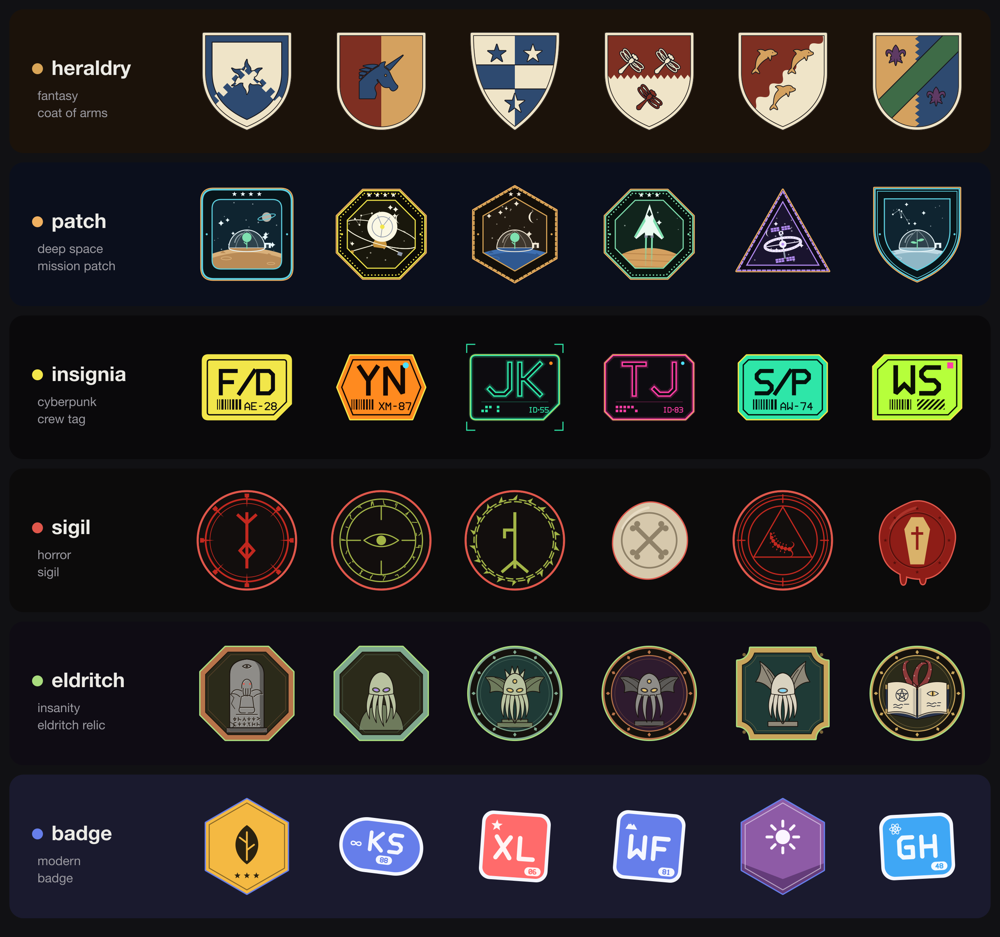
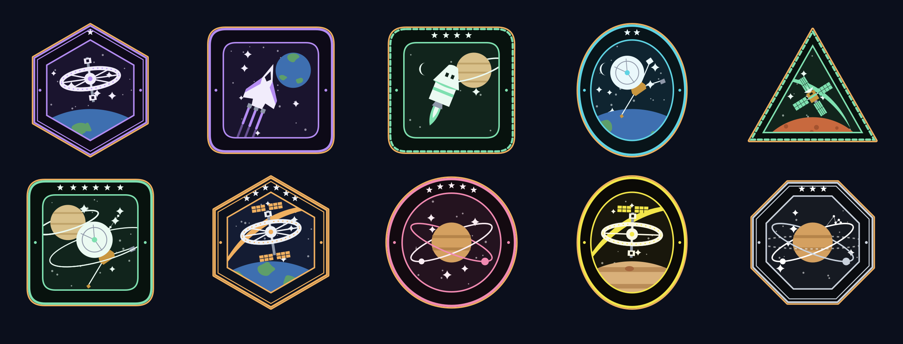

<p align="center">
  <a href="https://emblazon.mallen.us"></a>
</p>

<p align="center">
  <a href="https://emblazon.mallen.us"><b>Live site</b></a> ·
  <a href="https://emblazon.mallen.us/#try">Playground</a> ·
  <a href="https://emblazon.mallen.us/docs">API docs</a> ·
  <a href="https://emblazon.mallen.us/picker">Picker demo</a> ·
  <a href="docs/PLAN.md">Design notes</a>
</p>

<p align="center">
  <a href="https://github.com/brentonmallen1/emblazon/actions/workflows/ci.yml"></a>
</p>

**emblazon** turns any string into an emblem, like Robohash but with coats of arms, mission
patches and more. Send a username, an email or a UUID; get back an SVG and a one-line
description. The same input, theme and version always give the same emblem, so you never store
images: store the input and draw it again.

- **Six themes**, each made for one of jb-rpg's settings and drawn flat for dark screens.
- **An HTTP API** with batches of up to ten emblems per call, or **a library** with no
  dependencies that runs in browsers and Node alike.
- **Frozen versions**: a released theme version never changes, tested byte for byte.

## Themes



| Theme | Setting | What you get |
|---|---|---|
| `heraldry` | fantasy | A coat of arms with a proper blazon, e.g. *Azure, three bezants, a bordure Or.* |
| `patch` | deep space | A mission patch: craft, world and orbit, with a mission name |
| `insignia` | cyberpunk | A crew tag with real letters, a serial and a barcode |
| `sigil` | horror | A rune, eye or seal in a ring of thorns or wax |
| `eldritch` | insanity | A relic: idols, tablets and forbidden books |
| `badge` | modern | A clean badge with an icon or initials |

Every contact sheet is on the live site under **Themes**.

## Use it

### Over HTTP

Point an `` at the image route:

```html

```

Or ask for a batch and let the player choose. One call returns up to ten emblems:

```ts
const params = new URLSearchParams({ input: `${sessionId}:${heroName}`, theme: 'patch', count: '10', svg: '0' });
const { emblems } = await (await fetch(`https://emblazon.mallen.us/api/v1/emblems?${params}`)).json();

// Show emblems[i].url and emblems[i].description. Store the choice as { theme, input, version }.
```



| Endpoint | Returns |
|---|---|
| `GET /api/v1/emblems?input=&theme=&count=1..10` | Emblems with descriptions, version-pinned image URLs, configs and SVG (`svg=0` leaves it out) |
| `GET /{theme}/{input}.svg?v=` | The emblem as an image, for `` tags |
| `GET /{theme}/{input}.json?v=` | The emblem's description and config |
| `GET /api/v1/themes` | Themes, versions and screen colours |
| `GET /api/v1/openapi.json` | An OpenAPI 3.1 description |

All take `v` (version), `size`, `backdrop=dark` and `rim` (a colour). The first emblem in a batch
is always the plain emblem for the input; the rest are fixed variants, so a batch never changes
either. CORS is open, responses pinned with `v` are cacheable forever, and each client may make
120 requests a minute. The full reference, with errors and examples, is at
[emblazon.mallen.us/docs](https://emblazon.mallen.us/docs).

### As a library

No dependencies, no Node APIs, synchronous. Requires Node 23.6+ or any modern browser.

```ts
import { emblazon, emblazonMany } from 'emblazon';

const { svg, description, config } = emblazon('ada@example.com', { theme: 'heraldry', size: 64 });

// Up to ten different emblems for one input: the same set the API returns.
const set = emblazonMany(`${sessionId}:${heroName}`, { theme: 'patch', count: 10 });

// Store the choice as { theme, input, version } and draw it again any time:
const again = emblazon(chosen.input, { theme: chosen.theme, version: chosen.version });
```

- `emblazonOptions(seed, { count })` picks a set for pickers that varies the main motif where it can.
- `backdrop: 'dark'` adds a thin rim so the edge reads on near-black screens; `rim` sets its colour.
- `version` defaults to the theme's latest. Pin it if your emblems must never change.
- TypeScript apps with bundler resolution (Vite) can import `src/` directly; `just build` writes
  plain ES modules to `dist/` for everything else.
- Show `ATTRIBUTION` somewhere, such as an about screen; each emblem also lists its own `credits`.

## Develop

Needs Node 23.6+ and [just](https://github.com/casey/just). There is nothing to install: no
dependencies.

| Command | What it does |
|---|---|
| `just dev` | The site and API with reload on :4747: playground, docs, picker, sheets |
| `just test` | Frozen-version snapshots, corpus digests, per-theme rules, the API and the request handler |
| `just typecheck` | Type-checks the library and the Worker as a strict browser app would |
| `just stats [count] [theme] [version]` | How often two inputs look alike |
| `just assets` | Redraws and re-imports heraldic charges, then validates and compiles them |
| `just build` | Plain ES modules in `dist/` |
| `just readme-images` | Redraws the images in this README from real emblems |

Design, asset inventory and roadmap: [docs/PLAN.md](docs/PLAN.md).

## Deploy

**Cloudflare Workers** runs production at https://emblazon.mallen.us
([wrangler.toml](wrangler.toml)). Pages and the picker's modules are prerendered into `site/` and
served as static assets. The Worker ([worker.ts](worker.ts)) answers the API and images through
the same handler as the Node server, rate-limited by Cloudflare's binding.

[CI](.github/workflows/ci.yml) tests every push and pull request and deploys `main` when the
tests pass. It needs two repository secrets:

| Secret | Where to find it |
|---|---|
| `CLOUDFLARE_API_TOKEN` | Dashboard → My Profile → API Tokens → "Edit Cloudflare Workers" template, scoped to the account and the `mallen.us` zone |
| `CLOUDFLARE_ACCOUNT_ID` | The string after `com.cloudflare.api.account.` on the token summary, or in the dashboard URL |

By hand: `just cf-login` once, then `just deploy`. `just worker-dev` runs the Worker locally on
Cloudflare's runtime, and `just cf-tail` streams production logs.

**Docker** remains for self-hosting: `just docker-up`, or `just release [tag]` to push an image
to `REGISTRY_URL`. The Node server reads these settings (see [.env.example](.env.example)):

| Setting | Default | What it does |
|---|---|---|
| `PUBLIC_URL` | the request's host | Base URL for links in responses and docs. Set it in production. |
| `TRUST_PROXY` | off | Behind a proxy, take client IPs and the host from its forwarding headers. Without it, everyone behind the proxy shares one rate limit. |
| `RATE_LIMIT_PER_MINUTE` | `120` | Sustained requests per client per minute; `0` turns limiting off. |
| `RATE_LIMIT_BURST` | `60` | Requests a client may make at once. |

## Credits

Some heraldic charges are adapted from [game-icons.net](https://game-icons.net) (CC BY 3.0).
Anything that shows emblems must credit them: the exact line is in
[assets/CREDITS.md](assets/CREDITS.md), and each adapted charge carries it as `CHARGES[id].credit`.
